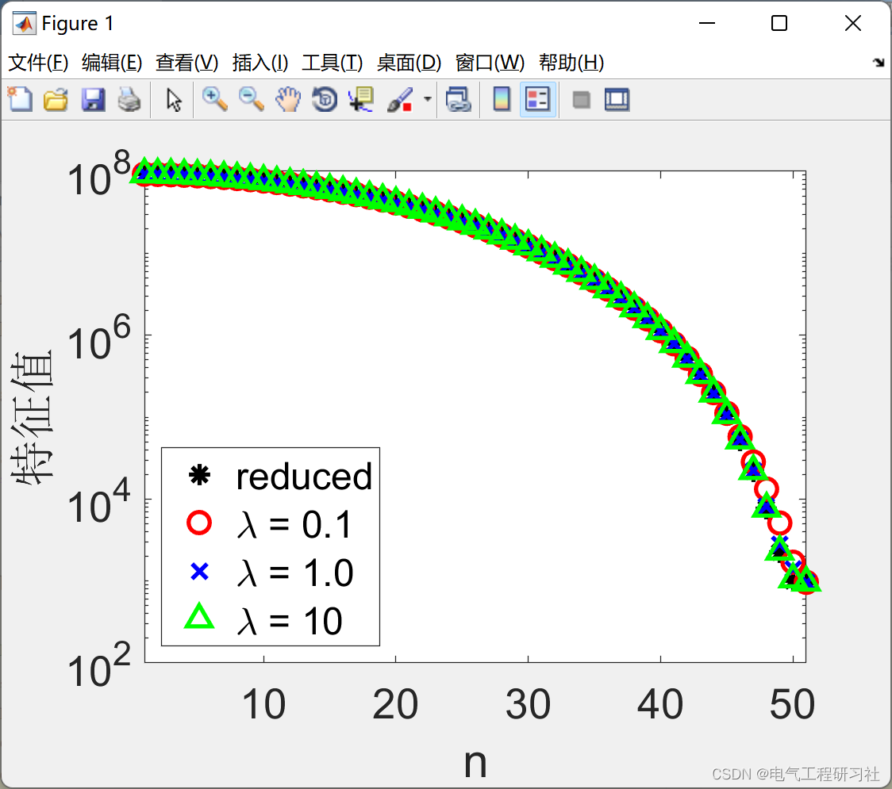
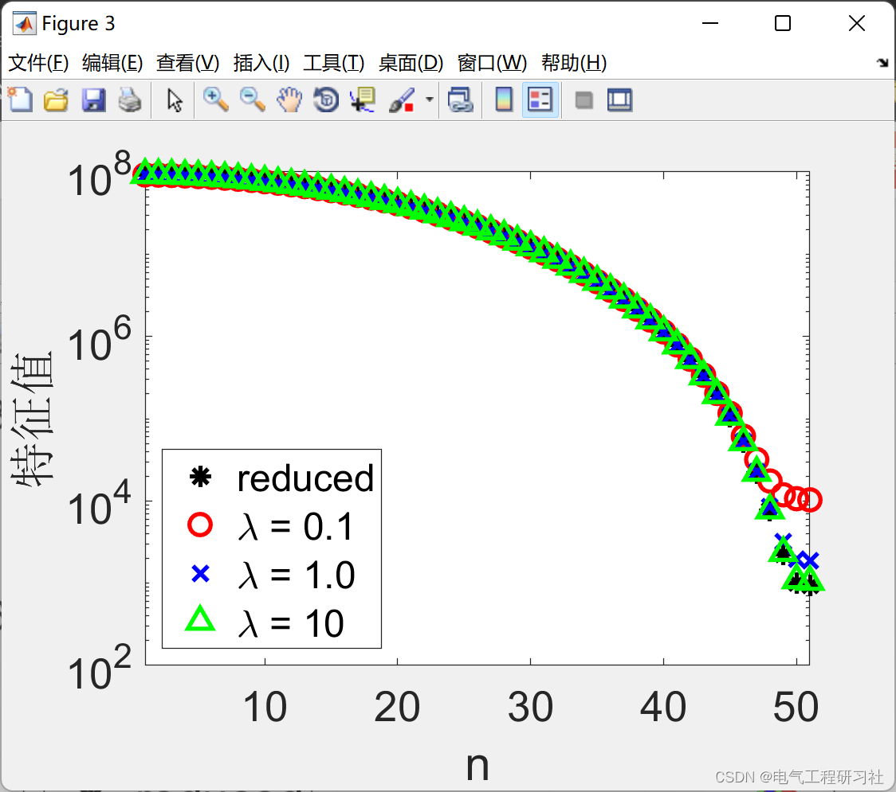
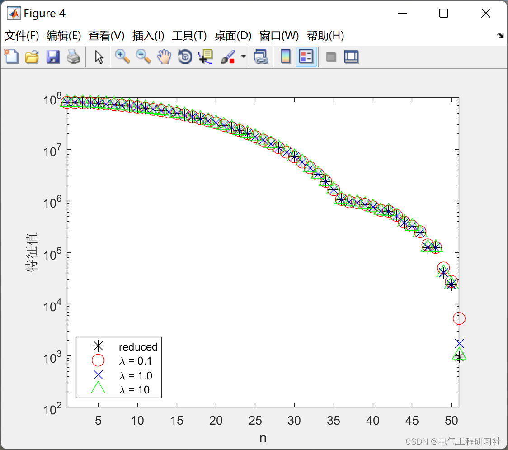

# PDE Optimization | Penalty Method for Constrained Optimization in Inverse Problems (Matlab Code Implementation)

1. Overview In inverse problems, the goal is to infer physical parameters (e.g., density, sound speed, or conductivity) from indirect observations. When the underlying model is described by partial differential equations (PDEs) (e.g., wave equations or Maxwell's equations), the observed data are typically partial measurements of multiple right-hand side PDE solutions. These parameters are often displayed as coefficients in the PDEs. These issues arise in many applications, such as geophysics [1, 2, 3, 4], medical imaging [5, 6], and nondestructive testing.
Many inverse and parameter estimation problems can be formulated as optimization problems with partial differential equations (PDEs) as constraints. Therefore, the goal is to infer parameters from partial measurements of several right-hand side PDE solutions, typically coefficients of the PDEs. Such a problem can be solved by finding a stationary point of the Lagrangian, which requires updating both parameters and (co-)state variables simultaneously. For large-scale problems, this one-time approach is impractical because it requires storing all state variables. In such cases, simplified methods are often adopted where the constraints are explicitly eliminated through solving the PDEs (at each iteration). Both methods and their variants are the mainstay for solving PDE-constrained optimization problems caused by inverse problems.In this paper, we propose an alternative approach aimed at combining the strengths of both methods. Our method is based on a quadratic penalty formula for constrained optimization problems. By eliminating state variables, we develop an effective algorithm with computational complexity roughly equivalent to traditional simplification methods while utilizing a larger search space. Numerical results indicate that this method indeed reduces some nonlinearity in the problem and exhibits lower sensitivity to initial iterations.
2 Mathematical Models for Linear Parabolic Equations: The inverse problem (discretized) can be formulated as a constrained optimization problem as follows:
In practice, a regularization term is usually included in the formula (1) to alleviate the ill-posedness of the problem. However, for simplicity, these terms are omitted because they can be added appropriately when needed.
In applications caused by the inverse problem, the constrained problem (1) is usually solved using Lagrange multipliers [7, 8] or Sequential Quadratic Programming (SQP) [9, 10]. This requires simultaneously optimizing parameters, states, and Lagrange multipliers (or accompanying state variables). Although from an optimization perspective, this one-time method is generally very attractive, it is not typically suitable for large-scale problems because we cannot store all K state variables at once. Instead, so-called simplified methods are based on (block) elimination of constraints to formulate unconstrained optimization problems on parameters:
If full measurements of the state are available (i.e., P is invertible), then the said inverse problem will be easier to solve. In this case, we can reconstruct the state from data as u = P−1d, and then recover parameters through solving:
Detailed mathematical models are described in Section 4.
3 Examples and Simulation Results
​Edit
​Edit
​Edit
​Edit
​Edit
4 Matlab Code and Article Reading
This article only showcases part of the code, with all codes and articles available in:
n  = 51;\nf  = 5;\nx  = linspace(0,1,n-1);\nh  = x(2) - x(1);\nmt = ones(n-1,1);\nomega = 2*pi*f;\n\nD  = spdiags(ones(n,1)*[-1 1]/h,[0:1],n-1,n);\nw  = ones(n,1); w([1 end]) = .5;\nAt = (1i*omega)*diags(w) + D'*diags(mt)*D;\n\n[Vr,Dr] = eig(full(At'*At)); [Dr,Ir] = sort(diag(Dr),'descend'); Vr = Vr(:,Ir);\nkappar  = Dr(1)/Dr(end);\n\na  = [1e-1 1 1e1];\nL  = [1 10 20];\nls = {'ro','bx','g^'};\n\nP{1} = speye(n);\nP{2} = fft(eye(n))/sqrt(n);\n\nfor k = 1:1\n    for l = 1:length(L)  \n        %I = randperm(n); I  = I(1:L(l));\n        I = round(linspace(1,n,L(l)));\n        Pl = P{k}(:,I);\n\n        mu = eigmax(@(x)At'\(Pl*Pl'*(At\x)),n);\n\n        figure;semilogy(1:n,Dr,'k*','markersize',10);hold on;\n        xlabel('n');ylabel('Eigenvalue');xlim([1 n]);\n\n        for i = 1:length(a)\n            lambda = a(i)*real(mu);\n            B = (At'*At) + (1/lambda)*(Pl*Pl');\n            %[Vp,Dp] = eig(full(diags(1./Dr)*ex(Vr'*B*Vr))); [Dp,Ip] = sort(diag(Dp),'descend'); Vp = Vp(:,Ip);\n            [Vp,Dp] = eig(full(B)); [Dp,Ip] = sort(diag(Dp),'descend'); Vp = Vp(:,Ip);\n            kappap(l,i) = Dp(1)/Dp(end);\n            lower = 1/(1+L(l)/(lambda*Dr(end)));\n            upper =   (1+L(l)/(lambda*Dr(1)));\n            \n            semilogy(1:n,abs(Dp),ls{i},'markersize',10);hold on;\n        end\n        legend('reduced',['\lambda = 0.1'],['\lambda = 1.0'],['\lambda = 10'],'location','SouthWest');\n    end\n\n    kappa{k} = kappap/kappar;\nend\n\nsavefig(1:3,'../../doc/figs/example2');\n\nlatextable(kappa{1},'Horiz',{'$\lambda = 0.1$','$\lambda = 1$','$\lambda = 10$'},'Vert',{['L = ' num2str(L(1))],['L = ' num2str(L(2))],['L = ' num2str(L(3))] },'Hline',[1 NaN],'format','%1.2e','name','../../doc/figs/example2.tex');\n\n\n  
​  

## Images

<!-- PAYMENT_BLOCK -->

## Get this dataset

- Payment link (Stripe): [Buy now](https://buy.stripe.com/3cs8yP7sY87d0vu9AB)
- Payment QR code: 

<!-- /PAYMENT_BLOCK -->
